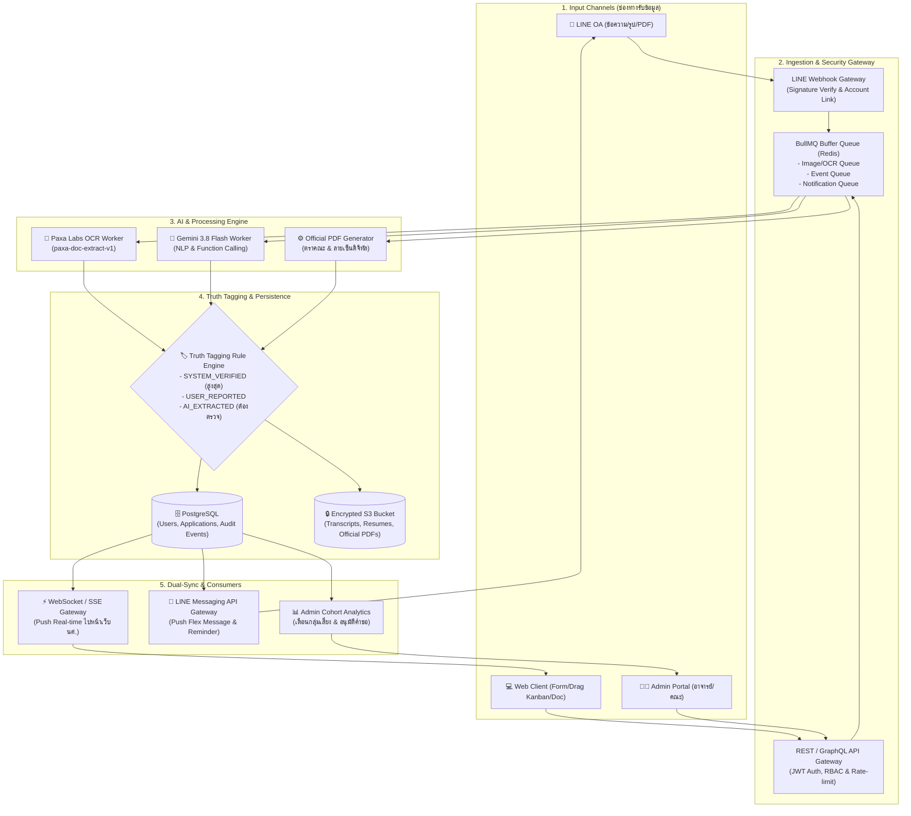

# InternMatch: Product Requirements Document (v2)

> **ผู้ช่วยพาคุณผ่านฤดูฝึกงาน**
> ฉบับ: 2.0 · วันที่: 10 พฤศจิกายน 2569 · สถานะ: Draft (ต่อยอดจาก PRD v1 และ POC)
> POC: https://chokky-education.github.io/internmatch-poc/

---

## 1. สรุปผู้บริหาร

InternMatch คือเครื่องมือที่พานักศึกษาผ่านฤดูหาที่ฝึกงานไปจนจบ ตั้งแต่เจอประกาศ สมัคร ติดตามผล เตรียมเอกสาร จนส่งเอกสารให้คณะครบและเริ่มฝึกงาน

**สิ่งที่เปลี่ยนจาก v1:** เราเลิกวางตัวเป็นแอปหางานหรือตัวรวมประกาศ (aggregator) เพราะสู้เรื่องจำนวนประกาศไม่ได้ เนื่องจากดึงประกาศได้เฉพาะจากแหล่งที่ได้รับอนุญาต จึงหันไปเน้นช่วงหลังจากเจองานแล้ว ซึ่งเป็นช่วงที่ยังไม่มีใครเข้ามาช่วย ได้แก่

1. **ขั้นตอนของคณะ** (ฝึกงานภาคบังคับ / สหกิจศึกษา)
2. **เอกสาร** ซึ่งเป็นคอขวดหลักของฤดูฝึกงาน
3. **การบอกว่าวันนี้ต้องทำอะไร** แทนการแสดงรายการงาน

---

## 2. ตำแหน่งผลิตภัณฑ์ (Positioning)

> สำหรับนักศึกษาที่ต้องหาที่ฝึกงานให้ได้ภายในเทอมนี้ InternMatch คือพื้นที่เดียวที่รวมทุกที่ที่คุณสนใจ ไม่ว่าเจอจากไหน บอกว่าต้องทำอะไรต่อ และไม่ปล่อยให้พลาดวันสำคัญ
> ต่างจากเว็บหางานที่จบหน้าที่ตรงคุณกดสมัคร **เราอยู่ด้วยจนคุณได้เริ่มฝึกงาน**

| | เว็บหางาน | Notion / Excel ทำเอง | **InternMatch** |
|---|---|---|---|
| ใช้กับงานจากทุกแหล่งได้ไหม | ไม่ (เฉพาะงานในเว็บตัวเอง) | ได้ แต่ทำเองทั้งหมด | **ได้ (วาง URL / แคปภาพ / แชร์เข้า LINE)** |
| เตือนวันสำคัญผ่าน LINE | น้อย | ไม่มี | **มี** |
| เข้าใจเงื่อนไขฝึกงานของมหาวิทยาลัยไทย | ไม่ | ไม่ | **มี** |
| จัดการเอกสาร | ไม่มี | ไม่มี | **มี + AI ช่วยอ่าน** |

### หลักการแบรนด์
- **ซื่อตรงเรื่องข้อมูล:** แยกข้อมูลที่ระบบยืนยันได้ (✔), ข้อมูลที่ผู้ใช้กรอกเอง (✎) และข้อมูลที่ AI อ่าน (🤖) ออกจากกันเสมอ
- **บอกงานถัดไป ไม่ใช่โชว์รายการ:** หน้าแรกตอบคำถามว่า "วันนี้ต้องทำอะไร"
- **LINE เป็นช่องทางหลัก:** นักศึกษาไทยไม่ค่อยเปิดอีเมล

### สิ่งที่จะไม่ทำ
- ไม่วัดความสำเร็จจากจำนวนประกาศ
- ไม่อ้างว่ารู้สถานะของเว็บภายนอกหรือของคณะได้อัตโนมัติ
- ยังไม่ทำฝั่งบริษัทใน MVP

---

## 3. ผู้ใช้เป้าหมาย

| Persona | รายละเอียด | ความต้องการหลัก |
|---|---|---|
| **มีน (กลุ่มหลัก)** | ปี 3 สาขาวิทยาการข้อมูล ต้องฝึกงานภาคบังคับ ≥ 240 ชม. | ได้ที่ฝึกงานทันกำหนดของคณะ และเอกสารครบ |
| **ต้น (กลุ่มรอง)** | ปี 2 สาย Software หาฝึกงานแบบสมัครใจ ยื่นไว้ 15 ที่ | ติดตามใบสมัครจำนวนมากโดยไม่ต้องอัปเดตเองซ้ำๆ |

---

## 4. ปัญหาที่ต้องแก้

| ปัญหา | ผลกระทบ |
|---|---|
| ประกาศกระจายหลายช่องทาง (Facebook, LINE, LinkedIn, เว็บบริษัท) | เสียเวลา และลิงก์จากโซเชียลดึงข้อมูลไม่ได้ |
| ติดตามสถานะจากหลายช่องทาง | ลืมว่าสมัครที่ไหนไปแล้ว และไม่รู้ว่าแต่ละที่ถึงขั้นไหน |
| **เอกสารเป็นคอขวด** | Transcript หมดอายุ ขาดเอกสาร และรอเอกสารจากคณะนาน |
| **ไม่รู้กำหนดการของคณะตัวเอง** | พลาดวันส่งเอกสารหรือวันลงทะเบียน |
| ต้องกรอกข้อมูลเองเยอะ | ผู้ใช้เลิกใช้หลังผ่านไปราวหนึ่งสัปดาห์ |

---

## 5. ฟีเจอร์และความต้องการ

ระดับความสำคัญ: **P0** = MVP · **P1** = ระยะ 2 · **P2** = ต่อยอด

### 5.1 เริ่มต้นใช้งาน: ตั้งค่าฤดูฝึกงาน (P0)
- เลือกมหาวิทยาลัย / คณะ / สาขา
- เลือกประเภท: ภาคบังคับ / สหกิจศึกษา / สมัครใจ → **เมนูปรับตามประเภท** (ผู้ที่เลือก "สมัครใจ" จะไม่เห็นเมนูเรื่องคณะ)
- ดึงกำหนดการของคณะมาให้ล่วงหน้า หรือให้อัปโหลดคู่มือ PDF ให้ AI อ่าน (ดู 5.7)
- ตั้งค่าความสนใจ: สายงาน รูปแบบการทำงาน พื้นที่ และช่วงเวลา

### 5.2 หน้า "วันนี้ต้องทำอะไร" (P0)
- นับถอยหลังถึงกำหนดส่งเอกสารให้คณะ
- แถบเส้นทาง 6 ขั้น: ค้นหา → สมัคร → สัมภาษณ์ → ได้ใบตอบรับ → เอกสารคณะ → เริ่มฝึกงาน
- รายการ "วันนี้ต้องทำ" พร้อมปุ่ม "ทำเลย" ที่พาไปหน้าที่เกี่ยวข้อง
- **หน้าวันแรก (ยังไม่มีข้อมูล):** แสดง 4 ขั้นเริ่มต้น ได้แก่ อัปโหลด Resume → เชื่อม LINE → บันทึกบริษัทเป้าหมาย 5 ที่ → ลงทะเบียนวิชาฝึกงาน
- กำหนดการที่ใกล้ถึง และใบสมัครที่ไม่อัปเดตเกิน 14 วัน

### 5.3 เอกสาร & ขั้นตอนคณะ (P0, จุดต่างหลัก)
- เช็กลิสต์ตามคู่มือคณะ (ลงทะเบียน, อาจารย์อนุมัติ, หนังสือขอความอนุเคราะห์, ใบตอบรับ, แบบฟอร์มของคณะ, ปฐมนิเทศ)
- แสดงที่มาของข้อมูล เช่น "คู่มือคณะ ปี 2569 · ตรวจ 1 พ.ย."
- สร้างร่างหนังสือขอความอนุเคราะห์จากข้อมูลใบสมัคร (P1)
- แชร์ความคืบหน้าให้อาจารย์ที่ปรึกษาดู โดยผู้ใช้ต้องอนุญาตก่อน (P1)
- ข้อมูลจากรุ่นพี่สาขาเดียวกัน เช่น อัตราการรับ เวลาตอบกลับ และเวลาออกใบตอบรับ (P2)

### 5.4 คลังเอกสาร (P0)
1. **เอกสารของฉัน:** Resume (หลายเวอร์ชัน), Transcript, Portfolio, Cover Letter, สำเนาบัตรนักศึกษา แต่ละใบมีสถานะ ✔ พร้อม / ⚠ ต้องแก้ / ✕ ขาด
2. **ความพร้อมเอกสารรายใบสมัคร:** ตารางบริษัท × เอกสาร สรุปเป็น "พร้อมส่ง" หรือ "ขาด X รายการ" โดยค่าเริ่มต้นมาจากตัวประกาศ (ผ่าน AI) และผู้ใช้แก้ได้
3. **เอกสารจากคณะ:** แถบขั้นตอน (ยื่นคำขอ → เจ้าหน้าที่ตรวจ → รอคณบดีลงนาม → ได้รับเอกสาร → ส่งบริษัท)
   - ติดป้าย **✎ อัปเดตโดยคุณ** เสมอ เพราะคณะไม่ได้เชื่อมต่อกับระบบ
   - วันที่คาดว่าจะได้ระบุที่มา เช่น "รุ่นพี่ 23 คน รอเฉลี่ย 5 วันทำการ"
   - เตือนทาง LINE เมื่อถึงวันที่คาดว่าเอกสารจะพร้อม

### 5.5 ค้นหาฝึกงาน (P0, เป็นทางเข้าทางหนึ่ง ไม่ใช่หน้าหลัก)
- ประกาศจากแหล่งที่ได้รับอนุญาตเท่านั้น
- ทุกการ์ดแสดงแหล่งที่มา วันที่ตรวจล่าสุด และป้าย "ข้อมูลอาจเก่า" / "ปิดรับใน X วัน"
- ค้นหา กรองตามรูปแบบงาน เรียงตามวันปิดรับ
- ปุ่ม "รายงานข้อมูลผิด"

### 5.6 ติดตามการสมัคร (P0)
- บอร์ด 5 คอลัมน์: บันทึกไว้ → สมัครแล้ว → สัมภาษณ์ → ได้ข้อเสนอ → ปิด/ไม่ผ่าน
- **✔ ยืนยันโดยระบบ** (สมัครผ่าน InternMatch): ผู้ใช้แก้สถานะเองไม่ได้
- **✎ อัปเดตโดยคุณ** (สมัครผ่านเว็บภายนอก): ย้ายคอลัมน์หรือเปลี่ยนสถานะได้ มีประวัติการเปลี่ยนแปลง
- ทางเข้าสำหรับใบสมัครภายนอก (เรียงจากเร็วสุด):
  1. **แชร์ลิงก์หรือภาพเข้า LINE OA** (P1)
  2. **อัปโหลดภาพแคปประกาศ → AI กรอกให้** (P0, ดู 5.7)
  3. วาง URL → "ดึงข้อมูล" (ถ้าเว็บนั้นอนุญาต ถ้าเป็น LinkedIn หรือ Facebook ให้แจ้งตรงๆ ว่าดึงไม่ได้)
  4. กรอกเอง
- ส่งต่ออีเมลจาก recruiter เข้ามา → ระบบเสนอสถานะใหม่ให้ผู้ใช้กดยืนยัน (P2)

### 5.7 อ่านเอกสารด้วย AI (P0, ใหม่)
ใช้ **Paxa Labs Document Extraction API** (`POST /v1/extract`, โมเดล `paxa-doc-extract-v1`)

| ประเภทเอกสาร | ฟิลด์ที่ดึง | สิ่งที่ระบบทำต่อ |
|---|---|---|
| 📢 โพสต์ประกาศงาน | บริษัท, ตำแหน่ง, สถานที่, รูปแบบ, ช่วงเวลา, เบี้ยเลี้ยง, วันปิดรับ, ทักษะ, เอกสารที่ต้องใช้, อีเมล, โทร | บันทึกเข้าบอร์ดติดตาม และตั้งค่าเอกสารที่ต้องใช้ให้ใบสมัครนั้น |
| 🎓 คู่มือคณะ | หลักสูตร, ชั่วโมงขั้นต่ำ, กำหนดการ (งาน + วันที่), แบบฟอร์ม, ผู้ประสานงาน | เพิ่มลงเช็กลิสต์คณะ |
| 📄 Transcript | ชื่อ, รหัส, สาขา, GPAX, วันที่ออกเอกสาร | เตือนเมื่อออกมาเกิน 3 เดือน |
| ✉️ หนังสือตอบรับ | บริษัท, ชื่อนักศึกษา, วันเริ่ม–จบ, ตำแหน่ง, ผู้ลงนาม, วันที่ | เตือนเมื่อไม่พบผู้ลงนาม |

**ความต้องการ:**
- รองรับ PNG / JPG / WebP / PDF (≤ 10 MB, ≤ 20 หน้า)
- **ต้องขอความยินยอมก่อนส่งไฟล์ไปยังผู้ให้บริการภายนอกทุกครั้ง**
- ผลลัพธ์ติดป้าย 🤖 "อ่านโดย AI: ตรวจก่อนบันทึก" และผู้ใช้แก้ไขได้ก่อนยืนยัน
- ช่องที่อ่านไม่ได้ให้แสดง "อ่านไม่พบ" พร้อมเหตุผล (จาก `missing` / `unverified`)
- ถ้าผลเป็น `status: incomplete` ให้เตือนว่าอาจเลือกประเภทเอกสารผิด

**ผลทดสอบเบื้องต้น (10 พ.ย. 2569):** ภาพโพสต์งานภาษาไทย 1 ภาพ อ่านได้ครบ 11/11 ฟิลด์ และแปลงปี พ.ศ. → ค.ศ. ถูกต้อง ใช้ 13 เครดิต (ยังต้องทดสอบกับภาพจริงอีกมาก ดูข้อ 9)

### 5.8 แชทบอท AI "พี่ฝึกงาน" (P0 บนเว็บ / P1 บน LINE OA)
ผู้ช่วย AI โต้ตอบภาษาพูดแบบสองทาง (Two-way Assistant) จำลองประสบการณ์แบบ abdul.chat แต่เน้นโดเมนการฝึกงานของไทยโดยเฉพาะ
- **สมองหลัก:** Gemini API (โมเดล `gemini-3.8-flash` ผ่าน Function Calling)
- **เครื่องมือที่ AI เรียกใช้งานได้ (Tools):**
  1. `get_overview`: ดึงข้อมูลสรุปของผู้ใช้ (ใบสมัคร, สถานะ, ความพร้อมเอกสาร, เช็กลิสต์คณะ, กำหนดการ) ก่อนตอบ
  2. `add_application`: เพิ่มงานลงในบอร์ดติดตาม พร้อมอัปเดตตารางความพร้อมเอกสาร
  3. `update_application_status`: อัปเดตสถานะใบสมัครภายนอก (Saved / Applied / Interview / Offer / Closed)
  4. `add_reminder`: ตั้งการเตือนวันเวลาสำคัญ
  5. `set_university_task`: ติ๊กความคืบหน้าในเช็กลิสต์ของคณะ
- **ความสามารถที่รองรับ:**
  - **ตอบคำถามและให้คำแนะนำ:** ขั้นตอนคณะ, วันส่งเอกสาร, ความหมายของหนังสือขอความอนุเคราะห์ vs ใบตอบรับ
  - **สั่งงานด้วยภาษาพูด:** เช่น "บริษัท B เรียกสัมภาษณ์ 20 พ.ย. 14:00" → ระบบย้ายสถานะและตั้งเตือนให้
  - **วิเคราะห์เอกสารแนบ (Multimodal + Paxa OCR):** ผู้ใช้แนบรูปภาพโพสต์งานหรือเอกสาร PDF ในแชท → ระบบส่งต่อให้ Paxa OCR สกัดข้อความ แล้วให้ Gemini วิเคราะห์และเสนอ Action บันทึกงานอัตโนมัติ
  - **ช่วยงานเอกสาร (Co-pilot):** ร่างอีเมลติดตามผล, ช่วยเกลา Resume ให้เข้ากับตำแหน่ง, ร่าง Cover Letter ตามข้อมูลจริงของบริษัท

### 5.9 แจ้งเตือน & LINE (P1)
- เชื่อม LINE ใน 3 ขั้น: เพิ่มเพื่อน OA → เชื่อมบัญชี → ยินยอม
- พัฒนา LINE Bot ตัวเดียวกันกับ "พี่ฝึกงาน" ให้สามารถแชท สั่งงาน และแชร์ภาพเข้า LINE OA ได้โดยตรง
- เปิด/ปิดได้ทีละประเภท: วันปิดรับ (ล่วงหน้า 3 วัน), สัมภาษณ์ (ล่วงหน้า 1 วัน), สถานะเปลี่ยน (เฉพาะที่ระบบยืนยันได้), เตือนให้อัปเดตใบสมัครภายนอก, เอกสารคณะพร้อม
- ยกเลิกได้ทุกเมื่อ หรือพิมพ์ "หยุด" ใน LINE

### 5.10 ฟีเจอร์ต่อยอด (P2)
- ซ้อมสัมภาษณ์ด้วย Paxa TTS + Speech-to-Text (อ่านคำถามที่รุ่นพี่เคยเจอ แล้วถอดคำตอบเก็บไว้ทบทวน)
- อัดเสียงสั้นๆ หลังสัมภาษณ์ → ระบบบันทึกเป็นโน้ตและวันนัดถัดไป
- แปล Resume / Cover Letter ไทย ↔ อังกฤษ (Paxa Translation)
- แดชบอร์ดสำหรับคณะหรืออาจารย์ (ช่องทางขาย B2B ให้มหาวิทยาลัย)
- ฝั่งบริษัท: ลงประกาศและจัดการผู้สมัคร

---

## 6. สถาปัตยกรรมและการไหลของข้อมูล (Data Pipeline Architecture)

InternMatch ออกแบบสถาปัตยกรรมแบบ **Event-Driven & Dual-Channel Sync** เพื่อรองรับการทำงานประสานกันอย่างไร้รอยต่อระหว่างนักศึกษา (ผ่าน LINE OA และ Web) และอาจารย์/เจ้าหน้าที่คณะ (ผ่าน Admin Portal)

### 6.1 แผนผังการไหลของข้อมูล (Mermaid Diagram)

### 6.2 การไหลของข้อมูลในแต่ละสถานการณ์ (Data Flow Scenarios)

#### 1) เมื่อนักศึกษากรอกข้อมูลผ่าน LINE OA:
* **กรณีส่งภาพโพสต์งาน:** LINE Webhook รับ Binary ➔ เข้า Queue ➔ Paxa OCR สกัดข้อมูล (บริษัท, ตำแหน่ง, วันปิดรับ, เอกสาร) ➔ ติดป้าย `AI_EXTRACTED` ➔ บันทึกลง PostgreSQL ➔ ตอบกลับ LINE ด้วย Flex Message เพื่อให้ นศ. ตรวจสอบ ➔ ยิง WebSocket อัปเดตการ์ดในบอร์ด Kanban บนเว็บทันที
* **กรณีพิมพ์ข้อความภาษาพูด ("บริษัท B นัดสัมภาษณ์ 20 พ.ย."):** LINE Webhook ➔ Gemini Function Calling สกัด Intent ➔ ตรวจสอบ Business Rules ➔ ติดป้าย `USER_REPORTED` ➔ อัปเดต DB ➔ ตั้ง Schedule Job ใน BullMQ ล่วงหน้า 1 วันเพื่อเตือนใน LINE ➔ หน้าเว็บย้ายการ์ดไปยังคอลัมน์ "สัมภาษณ์"

#### 2) เมื่อนักศึกษากรอกข้อมูลผ่าน Website:
* อัปโหลด Transcript / เอกสารผ่าน HTTPS ➔ ตรวจสอบ JWT Session ➔ เก็บไฟล์ลง Private S3 Bucket (เข้ารหัส AES-256) ➔ Paxa OCR ตรวจสอบวันที่ออกเอกสาร (อายุไม่เกิน 90 วัน) ➔ อัปเดตสถานะในตาราง Matrix ความพร้อมของเอกสาร ➔ แจ้งเตือนสถานะความพร้อมไปยัง Admin Portal ของอาจารย์

#### 3) เมื่ออาจารย์ / แอดมินคณะ อนุมัติข้อมูล (Admin Flow):
* อาจารย์เห็นภาพรวม Cohort และคิวคำขอรอตรวจ ➔ อาจารย์กด **"อนุมัติ & ออกหนังสือ"** ➔ ตรวจสอบ RBAC Token ➔ Background Worker สร้างไฟล์ PDF หนังสือขอความอนุเคราะห์ฉบับทางการ ➔ สแตมป์สถานะเป็น `SYSTEM_VERIFIED` ➔ บันทึก Audit Log ➔ **Dual-Push ทันที:** ยิง LINE แจ้งเตือน นศ. พร้อมลิงก์ดาวน์โหลด PDF + ติ๊กผ่านในหน้าเช็กลิสต์ของคณะบนเว็บ นศ. แบบ Real-time

### 6.3 กฎลำดับชั้นความน่าเชื่อถือของข้อมูล (Truth Hierarchy)
1. **`SYSTEM_VERIFIED` (สูงสุด):** ข้อมูลที่ออกโดยคณะ (เช่น หนังสือขอความอนุเคราะห์ที่อนุมัติแล้ว) หรือสถานะจากบริษัทที่สมัครผ่าน InternMatch ➔ *ผู้ใช้ไม่สามารถแก้ไขเองได้*
2. **`USER_REPORTED`:** ข้อมูลที่นักศึกษากรอกหรืออัปเดตเองผ่าน Web หรือ LINE ➔ *สามารถแก้ไขได้ และมีประวัติ Audit Log กำกับ*
3. **`AI_EXTRACTED` (ชั่วคราว):** ข้อมูลที่อ่านจากรูปภาพหรือเอกสารโดย AI ➔ *ต้องผ่านการตรวจทานและกดยืนยันจากนักศึกษาก่อนเลื่อนระดับเป็น USER_REPORTED*

---

## 7. ความเป็นส่วนตัวและความปลอดภัย (PDPA)

- Transcript และบัตรนักศึกษาเป็นข้อมูลส่วนบุคคล: เก็บเฉพาะที่จำเป็น เข้ารหัส และจำกัดสิทธิ์การเข้าถึง
- ขอความยินยอมแยกตามวัตถุประสงค์: (1) เก็บเอกสาร (2) ส่งให้ AI อ่าน (3) แชร์กับอาจารย์ (4) รับการแจ้งเตือนทาง LINE
- ตรวจสอบนโยบายการเก็บและใช้ข้อมูลของ Paxa Labs ก่อนใช้งานจริง และทำสัญญาประมวลผลข้อมูล (DPA)
- ผู้ใช้ลบหรือส่งออกข้อมูลของตัวเองได้
- API key ทุกตัวเก็บฝั่ง server และจำกัดวงเงินต่อคีย์

---

## 8. ตัวชี้วัดความสำเร็จ

| ประเภท | ตัวชี้วัด |
|---|---|
| **North Star** | % ผู้ใช้ที่ได้ใบตอบรับและส่งเอกสารให้คณะครบก่อนกำหนด |
| การใช้งาน | % ผู้ใช้ใหม่ที่ทำครบ 4 ขั้นเริ่มต้นภายใน 24 ชม. |
| การใช้งาน | จำนวนใบสมัครต่อผู้ใช้ และ % ที่มาจากภาพหรือลิงก์ (เทียบกับการกรอกเอง) |
| การกลับมาใช้ | % ผู้ใช้ที่กลับมาในสัปดาห์ที่ 2, 4 และ 8 ของฤดูฝึกงาน |
| คุณภาพ AI | % ฟิลด์ที่ผู้ใช้ต้องแก้หลัง AI อ่าน (เป้า < 10%) |
| เอกสาร | % ใบสมัครที่ขึ้นสถานะ "พร้อมส่ง" ก่อนวันปิดรับ |
| แจ้งเตือน | อัตราการเชื่อม LINE และอัตราการยกเลิกรับแจ้งเตือน |

---

## 9. แผนพัฒนา

| ระยะ | ขอบเขต | สมมติฐานที่ต้องพิสูจน์ |
|---|---|---|
| **0 · Validate** (ตอนนี้) | POC + สัมภาษณ์นักศึกษาปี 3 จำนวน 5–8 คน + ทดสอบ AI กับเอกสารจริง (โพสต์งาน 10 ภาพ, คู่มือคณะ 2–3 ฉบับ) | เอกสารและขั้นตอนของคณะเจ็บปวดกว่าเรื่องหางานไม่เจอ |
| **1 · MVP** | 5.1–5.7 สำหรับ 1–2 คณะนำร่อง | ผู้ใช้กลับมาใช้ตลอดฤดูฝึกงาน |
| **2 · LINE** | 5.8 + การแชร์เข้า LINE OA | การแชร์เข้า LINE ลดภาระกรอกข้อมูลได้จริง |
| **3 · Community / University** | ข้อมูลรุ่นพี่, แดชบอร์ดอาจารย์ | มหาวิทยาลัยยอมจ่าย หรือยอมเป็นพาร์ทเนอร์ |
| **4 · Company** | ฝั่งบริษัท + การเชื่อม API ที่ได้รับอนุญาต | |

---

## 10. ความเสี่ยงและแนวทางลดผลกระทบ

| ความเสี่ยง | แนวทาง |
|---|---|
| ข้อมูลกำหนดการคณะไม่ถูกต้องหรือล้าสมัย | ระบุที่มาและวันที่ตรวจ ให้ผู้ใช้แก้ได้ และใช้ AI อ่านคู่มือฉบับล่าสุด |
| AI อ่านผิด | ให้ผู้ใช้ตรวจก่อนบันทึกเสมอ แสดงเหตุผลเมื่ออ่านไม่ได้ และติดตามอัตราการแก้ไข |
| ต้นทุน AI ต่อผู้ใช้ | 13 เครดิตต่อหน้า: จำกัดจำนวนครั้งต่อเดือน และ cache ผลการอ่าน |
| ผู้ใช้เลิกอัปเดตสถานะเอง | อัปเดตด้วยภาพ / LINE / อีเมล และเตือนเมื่อเงียบนาน |
| ข้อมูลส่วนบุคคลรั่วไหล | ทำตามข้อ 7 และใช้ backend proxy |
| ผูกติดกับผู้ให้บริการ AI รายเดียว | ออกแบบ adapter ให้เปลี่ยนผู้ให้บริการ OCR ได้ |

---

## 11. ประเด็นที่ยังต้องตัดสินใจ

1. คณะนำร่องคือคณะไหน และได้คู่มือหรือกำหนดการมาจากใคร
2. รูปแบบรายได้: freemium สำหรับนักศึกษา (จำกัดจำนวนการอ่านด้วย AI) หรือ B2B ขายให้มหาวิทยาลัย
3. จะรองรับกลุ่ม "สมัครใจ" ตั้งแต่ MVP หรือรอระยะถัดไป
4. ขอบเขตของการแชร์ข้อมูลกับอาจารย์ (ดูได้อย่างเดียว หรืออนุมัติในระบบได้ด้วย)
