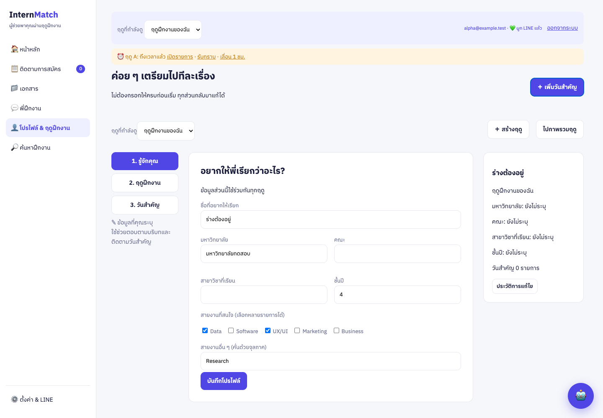
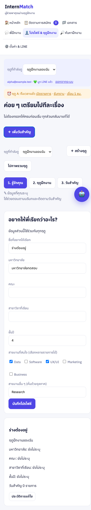
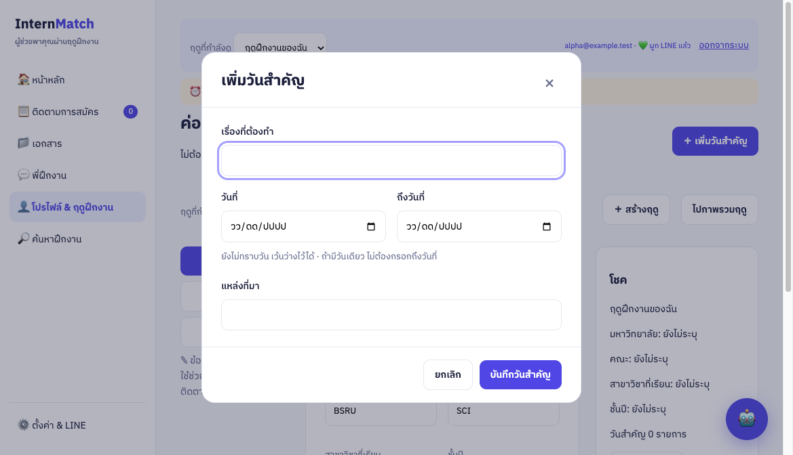
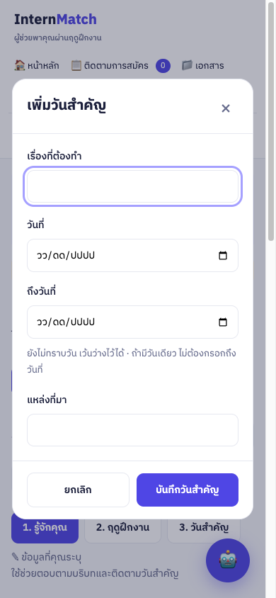

# Local UAT: โปรไฟล์และฤดูฝึกงาน

วันที่รายงาน: 13 พฤศจิกายน 2569

**ผลอัตโนมัติ: PASS — พร้อมให้ผู้ใช้ลอง Local**

**ผล UAT จากผู้ใช้: PASS — ผู้ใช้ยืนยันและอนุญาต release วันที่ 13 พฤศจิกายน 2569**

บันทึกรอบ Local UAT; การเปิด PR/CI/merge/deploy ติดตามแยกใน `docs/STATUS.md` และรายงาน release

Implementation ที่ตรวจ: `6185be84c039de2e51f650017904798324830aa1` บน branch `codex/student-profile-seasons` รวม migration/service foundation จาก commit ก่อนหน้า

## สภาพแวดล้อมและวิธีลอง

- เว็บจริง `http://localhost:8000/` → Local Worker `http://localhost:8787/` → D1 แยกแบบ ephemeral
- เปิด [หน้าบัญชีทดลอง](http://localhost:8000/scripts/uat/open.html) เลือกบัญชี A แล้วเข้าเมนู **โปรไฟล์ & ฤดูฝึกงาน**
- บัญชี A มีข้อมูลจากเส้นทางทดสอบ; บัญชี B มีข้อมูลเดิมที่ใส่ก่อน migration 0003 เพื่อทดสอบการย้าย
- ลองแก้ชื่อ/ชั้นปีและบันทึก สลับฤดู เพิ่มวันสำคัญ ตรวจ/ปรับการเตือน แล้วย้อนกลับหรือรีโหลด
- ทุกบัญชี/บริษัท/วันเป็นข้อมูลสมมติ การรีสตาร์ต UAT server จะเริ่มชุดข้อมูลใหม่ ไม่มีการแก้ D1 production
- วิธีเปิดเซิร์ฟเวอร์และทำซ้ำอยู่ที่ [Local UAT README](../../scripts/uat/README.md)

## ผลตาม 12 กรณี

| กรณี | ผลจริงและหลักฐาน | ผลอัตโนมัติ |
| --- | --- | --- |
| 1. เริ่มว่าง | browser เพิ่มใบสมัครโดยไม่กรอกโปรไฟล์ อ่านกลับหลัง reload; ตรวจ API ว่าโปรไฟล์ยังว่าง | PASS |
| 2. โปรไฟล์/ประวัติการศึกษา | browser บันทึกปี 3 → สร้างฤดู A → เปลี่ยนเป็นปี 4 → สร้าง B; A ยังปี 3 และ B ปี 4 | PASS |
| 3. แบบฟอร์มฤดู | browser บันทึกประเภทอื่น 270 ชั่วโมง สัปดาห์ไม่เกี่ยวข้อง และหลายสายงาน/ระบุเอง; อ่านหลัง reload ค่าว่างเป็น null; backend ปฏิเสธค่าศูนย์และวันที่ผิด | PASS |
| 4. ข้อมูลแยกฤดู | browser/API มี Same Company ในสองฤดูและเตือนไม่ปน; backend isolation suite ตรวจสถานะ task/document/keyword deletion และ foreign IDs | PASS |
| 5. เข้าถึงวันสำคัญ | browser เพิ่มวันแรก ยืนยัน แล้ว reload กลับมาพบภาพรวม; มี quick add และแก้จากรายการได้ | PASS |
| 6. เสนอเตือนก่อนสร้าง | browser ตรวจจำนวน reminder ก่อนยืนยันและเวลา 09:00 ไทยของช่วงวันที่ซึ่งนับจากวันสิ้นสุด; backend ตรวจวันที่ยังไม่ทราบและข้อเสนอที่หมดอายุ | PASS |
| 7. เลื่อนวัน/เตือน | browser ตรวจวันไม่เปลี่ยนก่อนยืนยันและ replay ไม่ซ้ำ; backend ทดสอบ atomic audit rollback, Cron claim, snooze ที่ใหม่กว่า และข้อเสนอเตือนแรกชนข้อเสนอแก้วัน | PASS |
| 8. เว็บ/LINE | ส่ง webhook ที่ลงลายเซ็นจริงเข้า Local Worker ใช้ OTP จำลองผูกบัญชี A; เสนอ/ยืนยันชื่อและฤดูผ่าน LINE; เว็บเก่าถูกปฏิเสธ 409 ก่อนเขียน | PASS |
| 9. การ์ด/OCR ค้าง | browser อัปโหลด OCR ผ่าน Worker สลับฤดูแล้วกดยืนยัน ข้อมูลอยู่ฤดูต้นทางและ AI_EXTRACTED; backend ตรวจ owner/expiry/version และหน่วง LINE image download ระหว่างสลับฤดู | PASS |
| 10. เตือนทุกฤดู | trigger Cron ในเครื่องขณะเลือกอีกฤดู; จำลอง LINE ล้มเหลว พบ unseen พร้อมชื่อฤดูจาก API; ทดสอบส่งสำเร็จด้วย provider จำลอง และตรวจ delivery ใน D1 | PASS |
| 11. ความผิดพลาด/สิทธิ์ | browser ตัด network และตอบ 401 แล้วร่างยังอยู่; session ที่หมดอายุได้ 401, foreign season ได้ 404; backend ตรวจ SYSTEM_VERIFIED, repeat request, rollback เมื่อ audit ล้มเหลว | PASS |
| 12. ย้ายข้อมูลเดิม | Wrangler local migration manager รักษาข้อมูลเดิม 8 ตารางทั้งหมดและ apply รอบสองไม่มี migration; runtime อ่าน legacy season; กด legacy card ขณะเลือกฤดูใหม่แล้วยังแก้เฉพาะฤดูเดิม | PASS |

เสริม: browser ตรวจจอ 320/390/1440px, ขยายข้อความจริง 200%, focus เข้า dialog, Tab/Shift+Tab อยู่ใน dialog, Escape ปิดและคืน focus ให้ปุ่มเดิม, ชื่อปุ่ม Dashboard อ่านได้, ไม่มี page errors และตรวจ persisted D1 ownership/audit channel/truth

## คำสั่งและผลตรวจ

- `cd worker && npx vitest run` — **136 tests / 17 files ผ่านทั้งหมด**
- inline `<script>` syntax และ `profile-ui.js` — ผ่าน
- `git diff --check` — ผ่าน
- `npx wrangler deploy --dry-run --outdir ../output/uat/worker-build` — bundle ผ่าน; เป็น dry-run ไม่ใช่ deploy
- `node scripts/uat/migration-check.mjs` — Wrangler migration preservation และ rerun guard ผ่าน
- `node scripts/uat/legacy-action-check.mjs` — legacy card ตรงฤดูต้นทางผ่าน
- Playwright CLI รัน `scripts/uat/browser.js` กับเว็บจริง — ผ่านทุก assertion
- Index refresh แล้ว

Log เต็มอยู่ในเครื่องที่ `output/uat/browser-run.log`, `backend-tests.log`, `migration-check.log`, `legacy-action-check.log`, `worker-build.log`, `keyboard-check.log` ไฟล์เหล่านี้เป็น local artifacts; สคริปต์ทำซ้ำอยู่ใน Git ไม่มี production secrets/OTP/session token ของผู้ใช้จริงในรายงาน

## สิ่งที่แก้ระหว่าง UAT และ review

1. เพิ่ม milestone version เมื่อยืนยันการเตือนชุดแรก เพื่อปฏิเสธข้อเสนอแก้วันซึ่งยังไม่เห็นการเตือนชุดนั้น
2. snooze เพิ่ม reminder version เพื่อไม่ให้ข้อเสนอเก่าเขียนทับเวลาล่าสุด
3. วันซึ่งเริ่มจากยังไม่ทราบสามารถเสนอ/เพิ่มเตือนเมื่อทราบวัน รวมกรณีปฏิเสธเตือนครั้งแรก
4. ยกเลิก/สลับฤดูไม่สำเร็จแล้วคืนค่าตัวเลือกบนหน้าจอให้ตรงกับข้อมูลที่กำลังดู
5. เตือนก่อนทิ้งร่างเมื่อเปิด dialog/เปลี่ยนส่วน; network/session ล้มเหลวเก็บฟอร์มไว้
6. จับฤดูของ LINE image ก่อนเริ่มโหลด media และรักษาบริบทในปุ่มเลือกชนิดเอกสาร
7. แก้ layout เดิมที่ล้นจอเล็ก และแยกเมนูโปรไฟล์/ฤดูออกมาให้เข้าถึงได้โดยตรง
8. ป้องกัน repeated application request สร้างข้อมูลซ้ำ และป้องกัน model flag ข้ามการยืนยัน OCR

หกข้อแรกมาจากผู้ทบทวนอิสระและแก้พร้อม regression tests; ไม่เหลือข้อสำคัญจาก review ที่ยังไม่ได้จัดการ

## ขอบเขตหลักฐานและสิ่งที่ยังต้องทำ

- Gemini, Paxa OCR, อีเมล และ LINE เป็น **provider จำลอง** ที่ intercept outbound ของ Worker; รับส่ง HTTP, auth, webhook signature, tools, cards/actions, audit และ D1 ใช้โค้ดจริง
- ยังไม่ได้ยืนยันคุณภาพการตีความภาษาธรรมชาติ/อ่านเอกสารของผู้ให้บริการจริง หรือการส่งเข้าแอป LINE จริง
- บัญชีทดสอบและ control endpoints มีเฉพาะ UAT entry ไม่ได้อยู่ใน production Worker entry
- รอผู้ใช้ลองหน้าจอ Local และบันทึก feedback ก่อนปิด UAT จากผู้ใช้ ไม่มีการถือว่าเงียบเท่ากับยอมรับ
- หลังจัดการ feedback ที่จำเป็นครบ จึงไป **PR → CI → Merge → Deploy** และตรวจ Worker/D1 แยกจาก Pages

## ภาพหน้าจอ

## Feedback ผู้ใช้รอบ 1: จัด layout หน้าต่างวันสำคัญ

ปรับป้ายชื่อให้อยู่เหนือช่องกรอก ช่องเรื่อง/แหล่งที่มาเต็มแถว วันที่สองคอลัมน์บน desktop และคอลัมน์เดียวบนมือถือ แยก header พร้อมปุ่มปิด และ footer ยกเลิก/บันทึกที่จัดกลุ่มเดียวกัน ใช้รูปแบบเดียวกันกับหน้าต่างสร้างฤดูและยืนยันเตือน

ตรวจ browser ที่ 1169×672, 390×844 และ 320×844: ช่องเรื่องเต็มพื้นที่ฟอร์ม ไม่มีแนวนอนล้น, focus/Tab/Escape ผ่าน และปุ่ม submit ยังคงอยู่ใน form เดิม ตรวจหน้าต่างสร้างฤดูและข้อเสนอเตือนโดยไม่เขียนข้อมูลเพิ่ม Backend suite ยังผ่าน 136/136 และ syntax ผ่าน ผู้ใช้ตรวจ layout ฉบับแก้แล้ว และยืนยันให้เปิด PR พร้อมทำ release ต่อ

